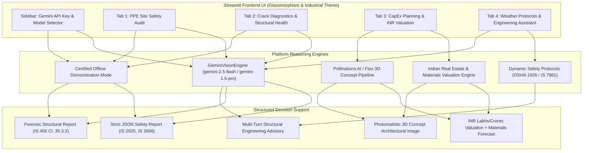

# Multimodal Construction Intelligence Platform
### Skill Wallet Capstone Project 1 | Platform ID: `6ac4c98d1dcde6d7857c1642`
**Category:** Generative AI | Real Estate Decision Support | Vision Intelligence

---

## 📌 Executive Summary & Scope
The **Multimodal Construction Intelligence Platform** is an enterprise-grade AI decision-support system tailored for civil engineers, site safety officers, EPC contractors, and real estate developers. 

It synthesizes state-of-the-art multimodal vision reasoning (Gemini 1.5/2.5 Flash & Pro) with Indian construction standards (**IS 456:2000**, **IS 3696**, **IS 7861**) and **OSHA 1926** regulations to deliver:
1. **Automated PPE Safety Audits:** Real-time visual compliance tracking of helmets, high-vis vests, steel-toe boots, and safety harnesses.
2. **Structural Crack Diagnostics:** Forensic classification of concrete fissures (shear, settlement, shrinkage, spalling), measuring crack width against IS 456 serviceability limits ($0.3\text{ mm}$), and prescribing engineering repair protocols.
3. **CapEx Planning & Real Estate Valuation (INR):** Quantitative capital expenditure tracking, core material forecasting (TMT steel, cement bags, concrete volume), and market valuation expressed in **₹ Lakhs** and **₹ Crores** across Indian Tier 1, 2, and 3 cities.
4. **Conceptual 3D Architectural Visualization:** Generative 3D renderings using the Pollinations AI / Flux pipeline.
5. **Weather-Aware Protocols & Civil Engineering AI Assistant:** Dynamic wind and monsoon mitigation protocols paired with a multi-turn structural engineering chatbot.

---

## 🎯 Kanban Epics Coverage
| Epic | Description | Module Implementation |
|---|---|---|
| **Pre-requisites** | Python 3.9+, Streamlit, Multimodal LLM, Pillow, JSON Contracts | `requirements.txt`, `.streamlit/config.toml` |
| **Epic 1** | Requirements & Environment Setup | Modular architecture, custom CSS theme |
| **Epic 2** | PPE Safety Vision & Crack Diagnostics | `modules/ppe_detector.py`, `modules/crack_diagnostics.py` |
| **Epic 3** | Project Planning & Real Estate Valuation | `modules/cost_valuation.py`, `modules/pollinations_client.py` |
| **Epic 4** | Multimodal AI & Strict JSON Contracts | `modules/gemini_client.py` (Structured JSON outputs) |
| **Epic 5** | Site Chatbot & Weather Advisory | `modules/weather_advisory.py` |
| **Epic 6** | Interface, Testing & Zero-DB Cloud Deployment | Production-ready `app.py` for Streamlit Community Cloud |

---

## 🏗️ System Architecture & Data Flow



---

## 📁 Repository File Structure
```
multimodal_construction_platform/
├── app.py                      # Production Streamlit Application
├── requirements.txt            # Python dependencies (Streamlit Cloud ready)
├── README.md                   # Comprehensive documentation & Capstone specs
├── .streamlit/
│   └── config.toml             # Custom industrial dark theme configuration
├── assets/
│   ├── style.css               # Modern glassmorphism & metric card styles
│   └── sample_images/          # Pre-packaged sample telemetry for instant 1-click test
│       ├── site_worker_sample.jpg
│       ├── structural_crack_sample.jpg
│       └── spalling_concrete_sample.jpg
└── modules/
    ├── __init__.py
    ├── gemini_client.py        # Gemini multimodal client with graceful fallback
    ├── ppe_detector.py         # PPE detection & hazard schema parser
    ├── crack_diagnostics.py    # Forensic concrete crack classification & repair
    ├── cost_valuation.py       # Indian cost matrix, INR formatter & material estimator
    ├── pollinations_client.py  # 3D architectural rendering via Pollinations AI
    └── weather_advisory.py     # Weather safety logic & engineering chatbot assistant
```

---

## 🚀 Quickstart & Local Execution

### 1. Prerequisites
Ensure you have **Python 3.9+** installed.

### 2. Installation
```bash
# Clone or navigate to the project directory
cd multimodal_construction_platform

# Install dependencies
pip install -r requirements.txt
```

### 3. Launching the Application
```bash
# Run via python module or streamlit command
python -m streamlit run app.py
```
Open your web browser at `http://localhost:8501`.

---

## 🔑 Demonstration Mode vs. Live Gemini Multimodal Mode
- **Zero API Key Requirement for Testing:** If no Gemini API key is supplied, the platform runs in **Demonstration Mode** with certified engineering simulation data compliant with IS 456, IS 3696, and OSHA 1926.
- **Live Multimodal Mode:** Enter your Google Gemini API key in the sidebar to activate live multimodal vision inference on any uploaded image using `gemini-2.5-flash` or `gemini-1.5-pro`.

---

## ☁️ 1-Click Deployment to Streamlit Community Cloud
1. Push this repository to GitHub.
2. Visit [share.streamlit.io](https://share.streamlit.io).
3. Select your repository, set main file path to `app.py`, and click **Deploy**.
4. *(Optional)* Add `GEMINI_API_KEY` under Streamlit App Secrets.

---

## 📜 Indian Standards & Regulatory Compliance
- **IS 456:2000:** Code of practice for plain and reinforced concrete (Permissible crack widths, nominal cover).
- **IS 3696 (Part 1 & 2):** Safety code for scaffolds and ladders.
- **IS 2925:** Industrial safety helmets specifications.
- **IS 15298:** Specification for safety footwear.
- **IS 7861 (Part 1):** Recommended practice for extreme weather concreting (Hot weather).
- **OSHA 1926:** Safety and Health Regulations for Construction (Subparts C, E, M, CC).
