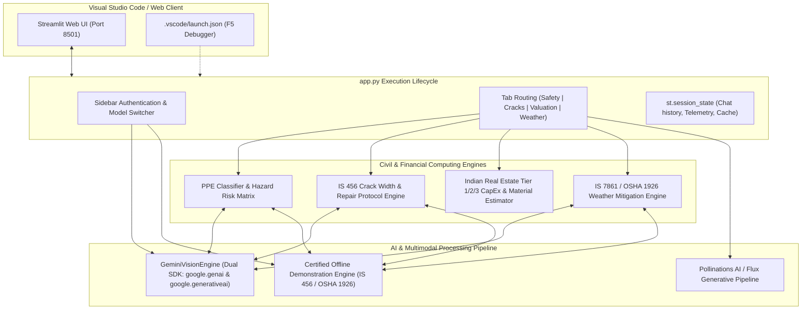

# Technical Architecture & Code Implementation Guide
## Multimodal Construction Intelligence Platform (Skill Wallet Capstone Project 1)
**Platform ID:** `6ac4c98d1dcde6d7857c1642` &bull; **Category:** Generative AI & Real Estate Decision Support

---

## 📑 Table of Contents
1. [VS Code Developer Setup & One-Click Debugging](#1-vs-code-developer-setup--one-click-debugging)
2. [End-to-End System Architecture](#2-end-to-end-system-architecture)
3. [Source Code Walkthrough & Technical Details](#3-source-code-walkthrough--technical-details)
   - [3.1 Main Application (`app.py`)](#31-main-application-apppy)
   - [3.2 Multimodal Vision Engine (`modules/gemini_client.py`)](#32-multimodal-vision-engine-modulesgemini_clientpy)
   - [3.3 PPE Compliance & Hazard Detection (`modules/ppe_detector.py`)](#33-ppe-compliance--hazard-detection-modulesppe_detectorpy)
   - [3.4 Forensic Crack Diagnostics (`modules/crack_diagnostics.py`)](#34-forensic-crack-diagnostics-modulescrack_diagnosticspy)
   - [3.5 CapEx Planning & Indian Real Estate Valuation (`modules/cost_valuation.py`)](#35-capex-planning--indian-real-estate-valuation-modulescost_valuationpy)
   - [3.6 3D Architectural Rendering via Flux (`modules/pollinations_client.py`)](#36-3d-architectural-rendering-via-flux-modulespollinations_clientpy)
   - [3.7 Weather-Aware Protocols & Civil Chatbot (`modules/weather_advisory.py`)](#37-weather-aware-protocols--civil-chatbot-modulesweather_advisorypy)
4. [Regulatory Standards Compliance Matrix](#4-regulatory-standards-compliance-matrix)
5. [Automated Testing Suite (`tests/test_platform.py`)](#5-automated-testing-suite-teststest_platformpy)

---

## 1. VS Code Developer Setup & One-Click Debugging

This codebase is pre-configured with complete VS Code workspace settings:

### Option A: 1-Click Launch via VS Code
1. Launch **Visual Studio Code**.
2. Select **File > Open Folder...** and select the `multimodal_construction_platform` folder.
3. Press **`F5`** (or go to **Run & Debug** and choose **`Streamlit: Run Platform (F5)`**).
4. VS Code will automatically start Streamlit and open the terminal:
   ```
   Local URL: http://localhost:8501
   ```

### Option B: 1-Click Batch File Launch
Double-click `run_streamlit.bat` in File Explorer, or in PowerShell execute:
```powershell
.\run_streamlit.ps1
```

---

## 2. End-to-End System Architecture



---

## 3. Source Code Walkthrough & Technical Details

### 3.1 Main Application (`app.py`)
- **UI Framework:** Streamlit 1.66+ with custom CSS injections (`assets/style.css`).
- **Sidebar Integration:**
  - Secure password field for the Google Gemini API key.
  - Model selection dropdown (`gemini-2.5-flash`, `gemini-1.5-flash`, `gemini-1.5-pro`).
  - Active visual status indicator badge: Green for live Gemini Multimodal API; Amber for Demonstration Mode.
  - Platform ID watermark: `6ac4c98d1dcde6d7857c1642`.
- **Tab Layout:**
  - `tab_safety`: Multimodal site photo audit, metric cards, status pills, JSON export.
  - `tab_cracks`: Structural concrete crack diagnostics, IS 456 threshold checks, engineering repair protocols.
  - `tab_planning`: Indian real estate cost matrix, CapEx calculation, material estimation, Flux 3D render generator.
  - `tab_weather`: Dynamic safety protocols (crane cutoffs, hydration retarders) and multi-turn civil engineering chatbot.

---

### 3.2 Multimodal Vision Engine (`modules/gemini_client.py`)
- **Dual SDK Architecture:**
  Supports both Google's newest SDK (`google.genai`) and legacy client (`google.generativeai`) with runtime fallback:
  ```python
  try:
      from google import genai
      GENAI_SDK_TYPE = "genai"
  except ImportError:
      import google.generativeai as legacy_genai
      GENAI_SDK_TYPE = "legacy"
  ```
- **Graceful Fallback Logic:**
  If no API key is supplied, or if the API key is invalid/quota exhausted, the engine flags `is_live = False` without crashing. Upstream callers seamlessly redirect to high-fidelity simulated models.
- **`clean_json_response(raw_text)`:**
  Strips Markdown code fences (````json ... ````) and applies regex pattern matching (`r"(\{[\s\S]*\})"`), ensuring zero JSON parsing crashes even if the LLM includes preamble comments.

---

### 3.3 PPE Compliance & Hazard Detection (`modules/ppe_detector.py`)
- **System Prompt Engineering:**
  Configured with OSHA 1926 and Bureau of Indian Standards (BIS) directives.
- **Strict JSON Contract Schema:**
  ```json
  {
    "safety_score": 72,
    "overall_status": "Partially Compliant",
    "workers_detected_count": 2,
    "ppe_detection": {
      "helmets": {"detected": 2, "compliant": 1, "non_compliant": 1, "standard": "IS 2925 / OSHA 1926.100"},
      "high_vis_vests": {"detected": 2, "compliant": 1, "non_compliant": 1, "standard": "OSHA 1926.201"},
      "steel_toe_boots": {"detected": 2, "compliant": 1, "non_compliant": 1, "standard": "IS 15298"},
      "safety_harnesses": {"detected": 2, "compliant": 1, "non_compliant": 1, "standard": "IS 3521 / OSHA 1926.502"}
    },
    "identified_hazards": [
      {
        "hazard_title": "Unprotected Edge Fall Hazard (> 2m)",
        "severity": "Critical",
        "zone": "Perimeter Slab Edge",
        "standards_violation": "OSHA 1926.501(b)(1) & IS 3696 Part 1",
        "corrective_remedy": "Issue immediate stop-work order..."
      }
    ]
  }
  ```

---

### 3.4 Forensic Crack Diagnostics (`modules/crack_diagnostics.py`)
- **Defect Classifications:**
  - *Structural Shear Crack:* Inclined 45-degree diagonal tension fracture near beam supports.
  - *Differential Settlement Crack:* Stepped diagonal crack across masonry and foundation junctions.
  - *Hairline / Plastic Shrinkage Crack:* Shallow surface crazing caused by rapid moisture loss.
  - *Thermal Expansion / Contraction Crack:* Regular vertical fractures across un-jointed long spans.
  - *Concrete Spalling & Rebar Corrosion:* Delamination of concrete cover with exposed rusted reinforcing steel.
- **IS 456:2000 Clause 35.3.2 Code Threshold:**
  $$\text{Allowable Surface Crack Width } w_{\max} = 
  \begin{cases} 
  0.30\text{ mm} & \text{Mild Exposure (Indoor/Protected)} \\
  0.20\text{ mm} & \text{Moderate to Severe Exposure (Exterior/Rain)} \\
  0.10\text{ mm} & \text{Water-Retaining Structures (IS 3370)}
  \end{cases}$$
- **Engineering Repair Protocol Formulation:**
  Prescribes ASTM C881 Type IV structural epoxy injection, high-pressure polyurethane grout seals, or Carbon Fiber Reinforced Polymer (CFRP) bidirectional wrapping.

---

### 3.5 CapEx Planning & Indian Real Estate Valuation (`modules/cost_valuation.py`)
- **Real Estate Cost Matrix (INR / sq. ft.):**
  - **Tier 1 (Mumbai, Delhi-NCR, Bengaluru):** Standard: ₹2,250 | Premium: ₹3,400 | Ultra-Luxury: ₹5,200
  - **Tier 2 (Pune, Ahmedabad, Kolkata):** Standard: ₹1,850 | Premium: ₹2,800 | Ultra-Luxury: ₹4,100
  - **Tier 3 (Coimbatore, Indore, Nagpur):** Standard: ₹1,550 | Premium: ₹2,300 | Ultra-Luxury: ₹3,400
- **Valuation & CapEx Equations:**
  $$\text{Total Construction Budget} = \text{Built-up Sqft} \times \text{Base Cost} \times \text{Structure Multiplier}$$
  $$\text{CapEx Incurred} = \text{Total Budget} \times \left(\frac{\text{Completion } \%}{100}\right)$$
  $$\text{Current Asset Valuation} = \text{Land Equity} + (\text{Finished Value} - \text{Land Equity}) \times \left(\frac{\text{Completion } \%}{100}\right) \times 0.95$$
- **Core Materials Forecasting Equations:**
  - TMT Reinforcement Steel: $\text{Steel (MT)} = \frac{\text{Built-up Sqft} \times (3.2 \text{ to } 5.2\text{ kg/sqft})}{1000}$
  - Cement Bags: $\text{Cement (50kg Bags)} = \text{Built-up Sqft} \times (0.28 \text{ to } 0.48\text{ bags/sqft})$
  - Ready-Mix Concrete (RMC): $\text{Concrete } (m^3) = \text{Built-up Sqft} \times (0.024 \text{ to } 0.042\text{ m}^3\text{/sqft})$
- **Indian Number System Formatter (`format_inr`):**
  Converts numbers into Lakhs (₹ 100,000) and Crores (₹ 10,000,000).

---

### 3.6 3D Architectural Rendering via Flux (`modules/pollinations_client.py`)
- **Dynamic Prompt Generator:**
  Generates photorealistic prompts tailored to structure classification, metro location, quality tier, and construction stage (e.g., exposed framing vs gleaming curtain wall facade).
- **Flux Endpoint Integration:**
  Generates high-resolution deterministic images via `https://image.pollinations.ai/prompt/{encoded_prompt}?width=1024&height=580&model=flux`.

---

### 3.7 Weather-Aware Protocols & Civil Chatbot (`modules/weather_advisory.py`)
- **Dynamic Weather Safety Actions:**
  - *High Wind (> 45 km/h):* Mandatory Tower Crane hook shutdown (OSHA 1926.1431), release of crane slewing brakes into free-weathervaning mode, grounding of suspended cradles.
  - *Heavy Rain / Monsoon:* Stop external slab concreting to prevent water-cement ratio alteration, activate 415V electrical ELCB trip tests, run basement dewatering pumps.
  - *Extreme Heat (> 40°C):* IS 7861 Part 1 compliance, limit fresh concrete temperature to $32^\circ\text{C}$ with ice-water substitution, dose with hydration retarders (ASTM C494 Type D), mandatory 15-min worker hydration intervals.
- **Interactive Multi-Turn Civil Engineering Chatbot:**
  Maintains conversational memory in `st.session_state["chat_messages"]` and provides technical engineering advisory citing IS 456, IS 1893 seismic codes, IS 875 wind loads, and OSHA standards.

---

## 4. Regulatory Standards Compliance Matrix

| Standard Code | Title / Jurisdiction | Implementation in Platform |
|---|---|---|
| **IS 456:2000** | Plain and Reinforced Concrete - Code of Practice | Concrete crack width threshold ($0.3\text{ mm}$), nominal cover requirements, compressive cube strengths |
| **IS 3696 (Part 1 & 2)** | Safety Code for Scaffolds and Ladders | Fall protection criteria for platforms $> 2\text{m}$ elevation |
| **IS 2925** | Specification for Industrial Safety Helmets | Cranial protection compliance in PPE vision audit |
| **IS 15298** | Safety Footwear Standards | Steel-toe puncture resistant footwear compliance |
| **IS 3521** | Industrial Safety Belts and Harnesses | Full-body fall arrest harness compliance |
| **IS 7861 (Part 1)** | Recommended Practice for Extreme Weather Concreting | Hot weather concrete placement and hydration temperature controls |
| **IS 875 (Part 3)** | Code of Practice for Design Loads (Wind) | Tower crane gust thresholds and windward face protection |
| **OSHA 1926 Subpart E, M, CC** | US Federal Construction Safety Regulations | Fall arrest anchorage criteria ($22.2\text{ kN}$), crane lift shutdown ($45\text{ km/h}$) |

---

## 5. Automated Testing Suite (`tests/test_platform.py`)

Run the test suite at any time in VS Code or Terminal:
```powershell
python tests/test_platform.py
```
**Verification Scope:**
1. Gemini Vision Engine & JSON Sanitizer validation.
2. PPE Site Safety Audit schema contract verification.
3. Concrete Crack Diagnostics and IS 456 permissible width check.
4. Indian Real Estate Valuation & Material Estimator calculations.
5. Pollinations AI 3D Render Prompt Generator test.
6. Weather Mitigation Protocols & Civil Engineering Chatbot verification.
